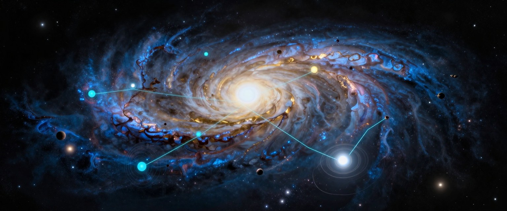

# universe-generator

Seeded galaxies, star systems, planets and moons in TypeScript. The same seed gives the same universe here as in the C# and Unity [UniverseGenerator](https://github.com/m4bwav/UniverseGenerator), bit for bit, checked against that project's own golden files.

**Work in progress.** The deterministic core (PCG32, seeds, deterministic maths) passes the C# golden file `core.json`; the galaxy, system and planet generators are being ported one golden file at a time. It is not on npm yet.

## License

MIT
